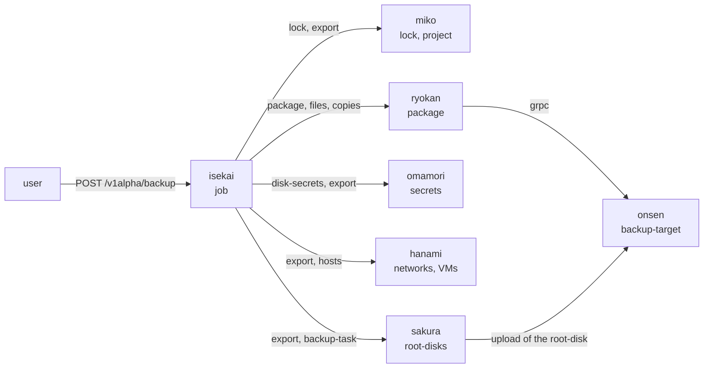
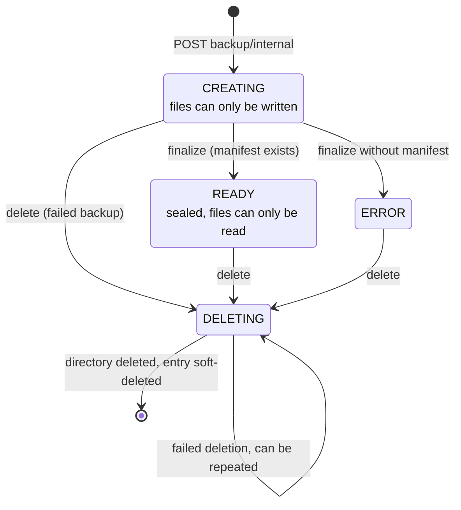
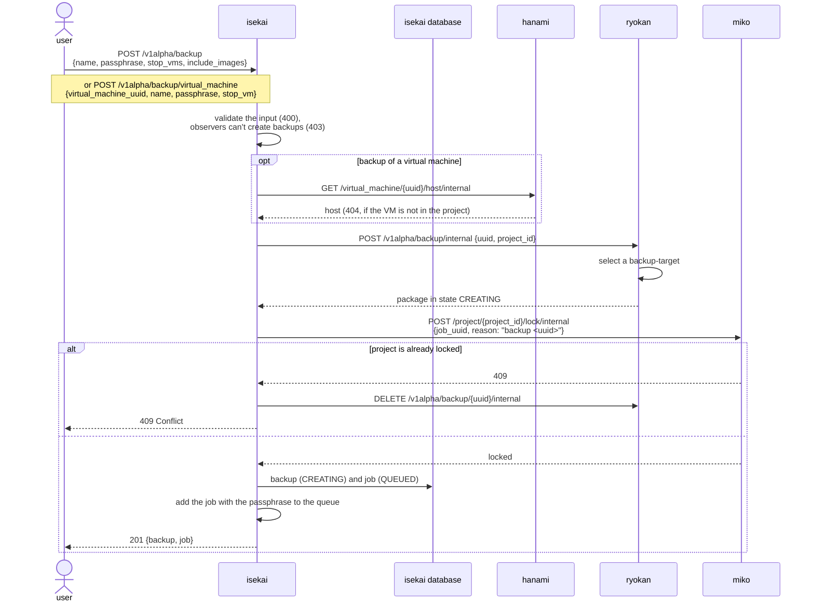
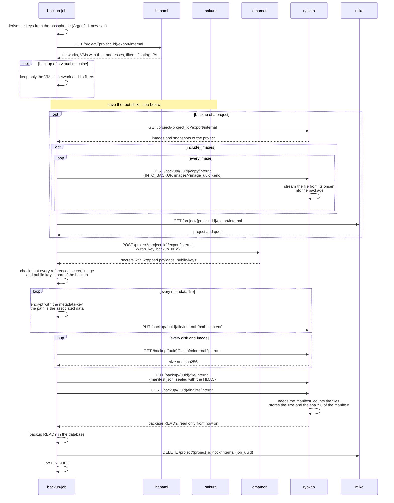
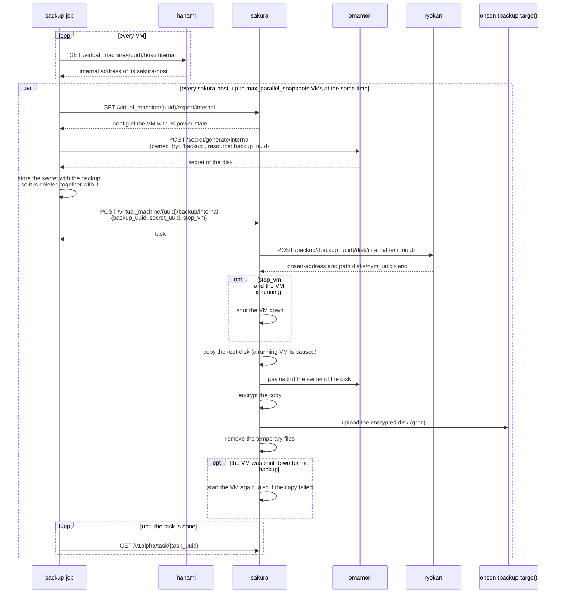
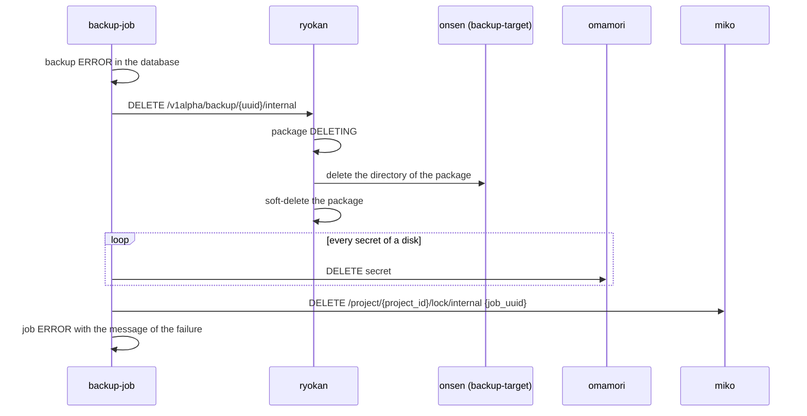

# Creation of a backup

Isekai saves a single virtual machine or a whole project as backup. It stores no data itself: it
collects the metadata of the other components, lets the sakura-hosts save the root-disks and
writes everything as one package onto an onsen-host, which an admin marked as backup-target. The
package is self-contained and encrypted with a key, which is derived from the passphrase of the
backup, so it can also be copied into another deployment and restored there (see
[Restore of a backup](backup_restore.md)).

The backup runs as job in the background. The project is locked for the whole job, so the disks
and the metadata of the backup belong to the same state of the project.

## Components

| Component | Role |
|---|---|
| **isekai** | Accepts the request, locks the project and runs the job, which calls all other components. It derives the keys of the backup, encrypts the metadata and writes the manifest. |
| **miko** | Holds the lock of the project and rejects all writes of the users to the project, while it is locked (`423`). Exports the project with its quota. |
| **ryokan** | Owns the package of the backup on the backup-target: creates it, writes and reads its files, copies the images into it and seals it at the end. It is the only component, which talks with the onsen of the backup-target about the package. |
| **onsen** (backup-target) | Stores the files of the package in `backups/<backup_uuid>/`. It never stores normal images or snapshots. |
| **omamori** | Generates a secret for every disk of the backup and exports the secrets and public-keys of the project with their payloads wrapped by the key of the backup. |
| **hanami** | Exports the networks, virtual machines, network-filters and floating IPs of the project and returns the sakura-host of every virtual machine. |
| **sakura** | Exports the config of a virtual machine and saves its root-disk encrypted into the package, as task of the virtual machine. |



## Content of the package

```text
backups/<backup_uuid>/
├── manifest.json            # format, kind, project, kdf-parameters and salt, sha256 and size of
│                            # every file, authenticated with a HMAC
├── metadata/                # every file AES-256-GCM encrypted with the metadata-key
│   ├── miko.json.enc        # only for a backup of a project
│   ├── omamori.json.enc     # payloads of the secrets wrapped with the wrap-key
│   ├── ryokan.json.enc      # only for a backup of a project
│   ├── hanami.json.enc
│   └── sakura.json.enc
├── images/<image_uuid>.enc  # only for a backup of a project with include_images
└── disks/<vm_uuid>.enc      # root-disks, encrypted with their own secrets
```

The keys come from the passphrase: `Argon2id(passphrase, salt)` gives the master-key, from which
`HKDF` derives the metadata-key, the wrap-key and the key of the HMAC of the manifest. The secrets
of the disks are part of `omamori.json.enc`, so the package needs nothing from the deployment,
which created it.

A backup of a virtual machine only contains the virtual machine with its root-disk, its network,
its network-filters and its public-key. The project, its quota and the images are not part of it.

## States of the package

Ryokan tracks the package as one resource and only allows the operations, which keep it
consistent. Every change of the state is a conditional update in its database, so of two
concurrent changes only one succeeds.



The backup in isekai has the same states. Isekai sets its entry to `READY` after ryokan sealed the
package and to `ERROR`, if the job failed.

## Start of the backup

The request is checked, the package is created and the project is locked, before the job is
queued. So a project, which is already locked by another backup, a restore or an admin, is
rejected right away. Everything, which was done before a failure, is reverted again.



The passphrase is only held in the memory of the queued job and is never stored or logged. The
options of the job, which are stored in the database, don't contain it.

## The job

The job runs on one of the worker-threads of isekai. Its current step is stored in the job, so the
user can follow it with `GET /v1alpha/job/{job_uuid}`.



The manifest is written as last file, so a package without manifest is known to be incomplete.
It is never finalized and ignored by the scan for foreign backups.

### Saving of the root-disks

The virtual machines are grouped by their sakura-host. The hosts work in parallel, every host
saves at most `processing.max_parallel_snapshots` disks at the same time.



The backup-task is a task of the virtual machine, like a snapshot, so it runs after the tasks,
which were queued before, and no other task of the virtual machine runs at the same time. The disk
is never registered as image in ryokan, it only exists within the package.

Without `stop_vms` the virtual machines are only paused, while their disk is copied. The backup is
then crash-consistent: data, which an application still holds in its memory, is missing.

## Failure of the job

The backup doesn't change the project itself, so a failed backup is removed completely and the
project is unlocked again.



Every part is cleaned up independently, so one failed step doesn't leave the rest behind. The job
keeps the error of the backup itself, the errors of the cleanup are only logged.

If isekai is restarted, while a job is queued or active, the job and its backup are set to
`ERROR` at the start. The passphrase and the token of the job only existed in the memory, so the
job can't be continued and nothing can be cleaned up in the other components right away. The
files of the incomplete backup are removed and the project is unlocked, when the user deletes the
backup.

## Deletion of a backup

`DELETE /v1alpha/backup/{backup_uuid}` deletes the package with all its files over ryokan, the
secrets of its disks in omamori and the entry in isekai. A backup, whose job is still running, is
rejected with `409`. A failed deletion leaves the package in `DELETING`, so it can be repeated.
