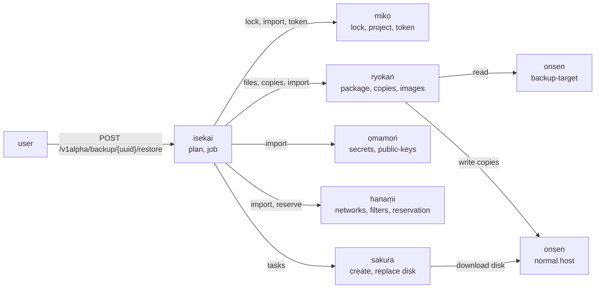
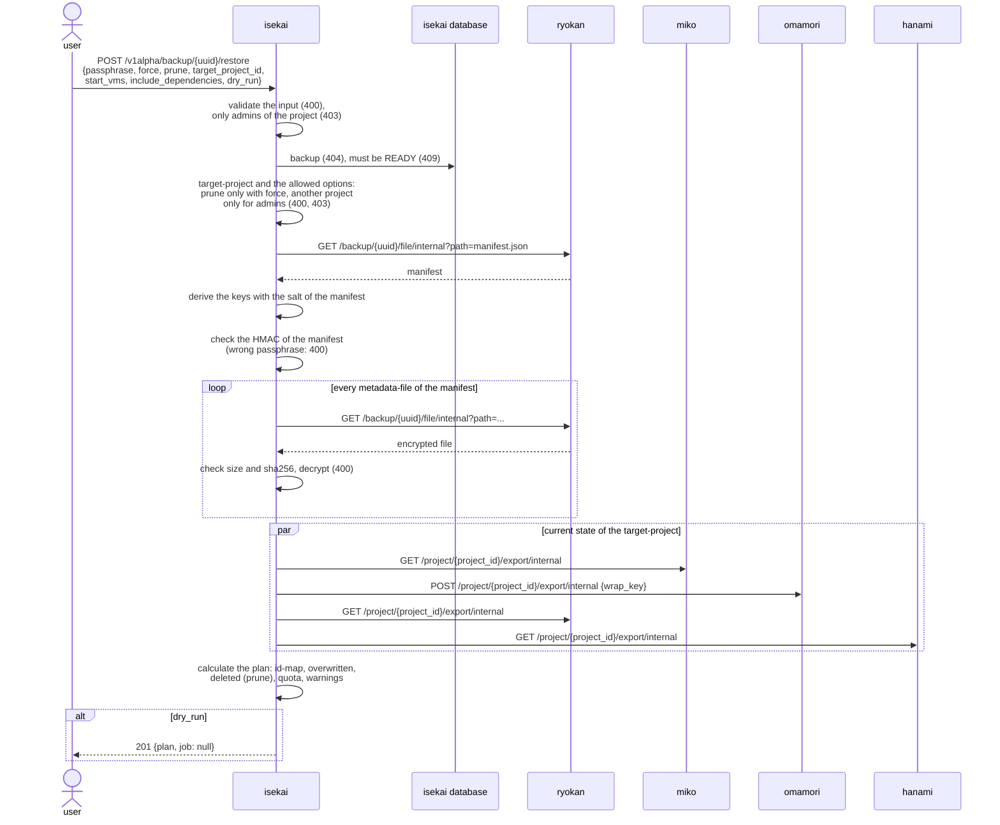
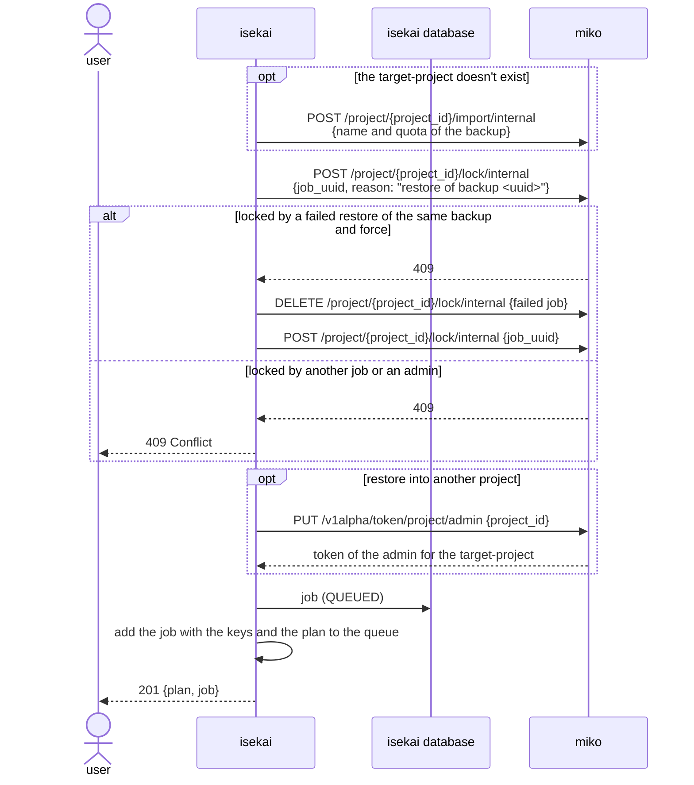
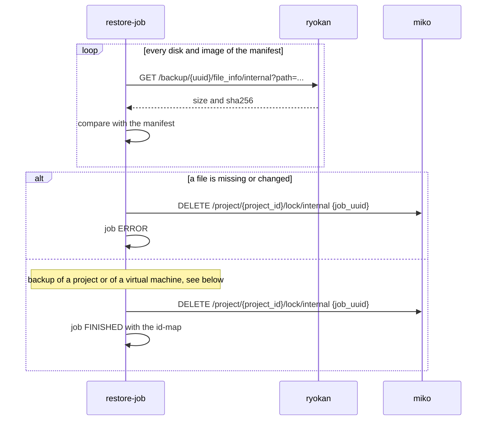
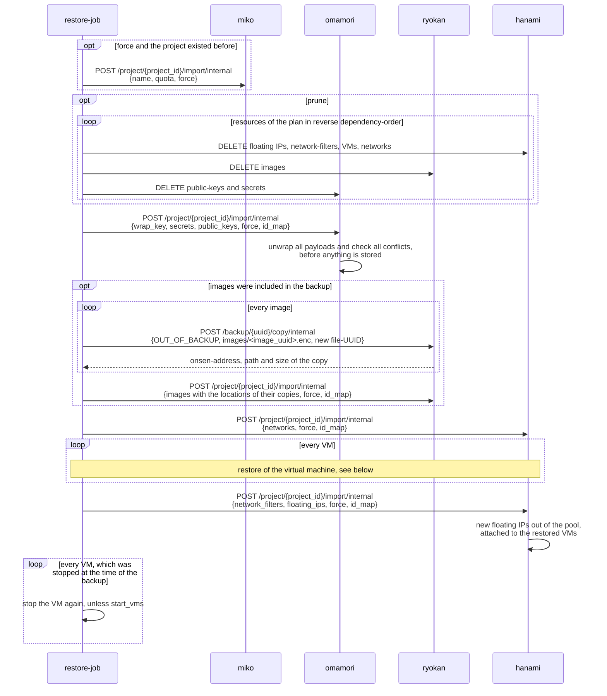
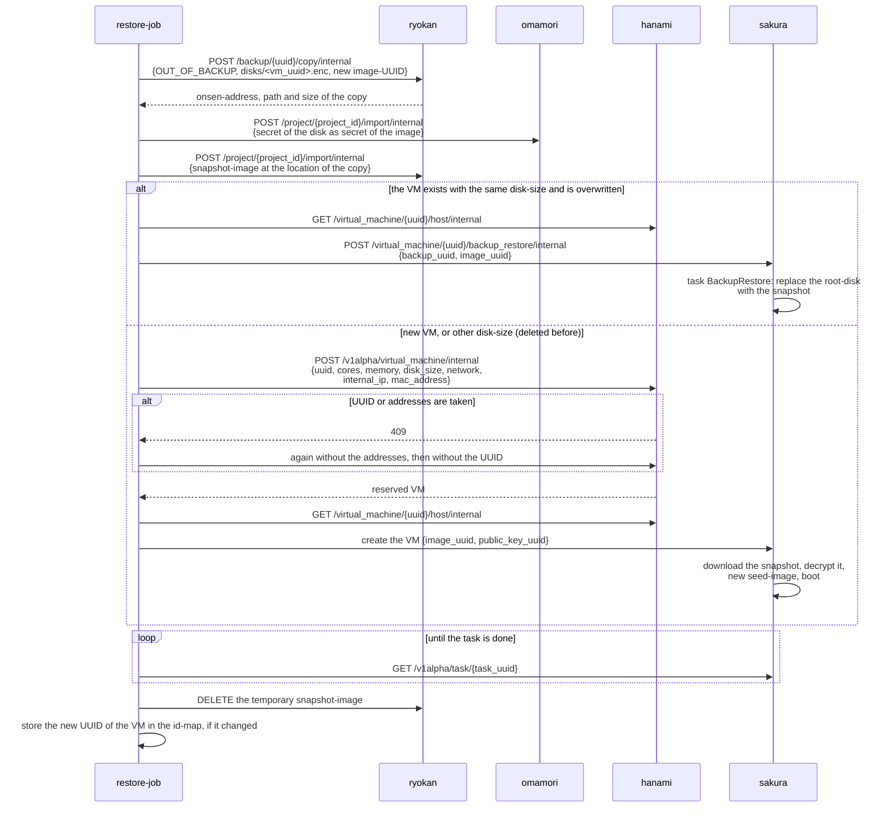
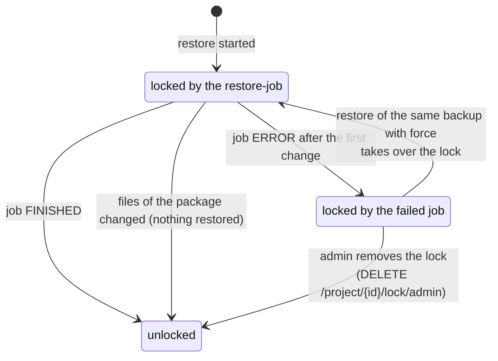

# Restore of a backup

Isekai restores a backup, which was created by [the backup of a project or a virtual
machine](backup_create.md), into its own project or into another one. The restore never changes
the package of the backup: the disks and images are copied out of it to normal onsen-hosts, so the
same backup can be restored again and again.

The request first verifies the backup and calculates the plan of the restore, before anything is
changed. The restore itself runs as job in the background, while the target-project is locked.

## Components

| Component | Role |
|---|---|
| **isekai** | Verifies the manifest and decrypts the metadata, calculates the plan, locks the target-project and runs the job, which calls all other components. |
| **miko** | Holds the lock of the target-project, creates a missing project and gives an admin a token for the target-project. |
| **ryokan** | Reads the files of the package, copies the disks and images out of it to normal onsen-hosts and registers them as images of the project. |
| **onsen** | The backup-target, which holds the package, and the normal onsen-hosts, which get the copies. |
| **omamori** | Unwraps the payloads of the secrets with the wrap-key of the backup and stores them encrypted with its own key. Imports the public-keys. |
| **hanami** | Imports the networks, network-filters and floating IPs and reserves the virtual machines with their original UUID and addresses, if they are free. |
| **sakura** | Creates a new virtual machine from the restored disk or replaces the root-disk of an existing one. |

## Options

| Option | Effect |
|---|---|
| `force` | Existing resources with the same UUID are overwritten. Without it, a resource, whose UUID is already used, gets a new UUID. |
| `prune` | Only together with `force` and only for a backup of a project: the resources of the project, which are not part of the backup, are deleted. |
| `target_project_id` | Restores into another project. All resources get new UUIDs there, because their UUIDs are usually still used by the project of the backup. A missing project is created, which only an admin can do. |
| `start_vms` | Starts all restored virtual machines. Without it, a virtual machine, which was stopped at the time of the backup, is stopped again. |
| `include_dependencies` | Only for a backup of a virtual machine: a missing network is created from the backup. |
| `dry_run` | Only returns the plan, without changing anything. |

## Verification and plan

Everything up to the plan only reads. A wrong passphrase or a manipulated metadata-file is
rejected with `400`, before the project is locked or changed.

The plan decides the UUID of every resource of the backup:

- with `force` every UUID is kept and an existing resource is overwritten,
- without `force` a resource keeps its UUID, if it is free in the project, otherwise it gets a new
  one, which is stored in the id-map,
- restored into another project, every resource gets a new UUID.

All references between the resources, like the network of a virtual machine or the secret of an
image, are rewritten with the id-map. The quota of the project after the restore is calculated as
well, a restore, which would exceed it, is rejected with `409`.

## Start of the restore

The other components act on the project of the token, for example hanami reserves a new virtual
machine within it. So a restore into another project gets a token of the admin for this project,
also if the admin is not assigned to it.

A failed restore keeps the project locked. Only a second restore of the same backup with `force`
takes over its lock, because only the job, which holds a lock, can remove it. Every other lock,
like the one of a running backup or of an admin, is never taken over.

## The job

The job checks the disks and images of the package against the manifest first, so a manipulated
package changes nothing. If this check fails, the project is unlocked again, because it wasn't
changed yet.

### Restore of a project

The resources are restored in the order of their dependencies.

Floating IPs are always allocated again from the pool of the target. Their old address is only a
preference, so the restore can also be imported into another deployment.

### Restore of a virtual machine

A virtual machine of a backup of a project, and the one of a backup of a virtual machine, is
restored from its disk in the package:

The snapshot-image is only needed to create the root-disk, so it is deleted again afterwards. A
new virtual machine gets a new seed-image, so its cloud-init runs with the restored public-key.

For a backup of a virtual machine, its public-key and its network are restored first, if they
don't exist in the target-project anymore. They get a new UUID, if their UUID is used by another
project. A missing network is only created, if `include_dependencies` is set. Afterwards the
network-filters of the virtual machine are imported and its power-state is applied like for a
project.

## Failure of the job

The steps are idempotent, so a failed restore can be repeated. The job ends in `ERROR` with the
step, which failed, and its message. The resources, which were already restored, stay, and the
project stays locked, so nobody works on a half restored project.

A restart of isekai sets an active restore-job to `ERROR`. Its project stays locked like after
every failed restore.
