# Key-exchange of the network-encryption

The traffic between the virtual machines of a network, which run on different hosts, is encrypted
with IPsec. The keys of these encrypted routes are never sent over the wire: all torii of a
network form an [MLS](https://www.rfc-editor.org/rfc/rfc9420.html) group, and each torii derives
the keys of its IPsec Security Associations (SAs) from the secret of the current epoch of the
group.

A network, which was created with `disable_encryption: true`, skips all of this: the routes
between the hosts of the network are not encrypted, hanami signs no grants for it, so its torii
never subscribe to a group of it.

## Components

| Component | Role |
|---|---|
| **hanami** | Decides, which torii may be member of which group. It signs a membership-grant for every host, which gets a VM of a network, refreshes all grants every 5 minutes and revokes a grant, when the last VM of the network is gone from the host. When a host registers itself again after a restart, it pins the new identity of its torii and changes the routes of the other gateways to the new address of the host. |
| **izakaya** | Shares the key-packages, delivers the MLS-messages and coordinates the groups: one queue of changes per group, which it hands to one committer per group in batches, and the regular key-rotation. It removes members, which stay silent. It has no part in the switch of the keys. Its state lives in its database, so several instances can run next to each other. |
| **torii** (VM-host) | MLS-client with its underlay-address as identity. A background-loop (the *agent*) subscribes to the groups, makes the changes as committer, processes the messages and installs the derived keys in the kernel. It switches the keys towards every other torii on its own, only coordinated with that torii. |
| **torii** (edge) | Never member of a group, the routes from and to it are never encrypted. |

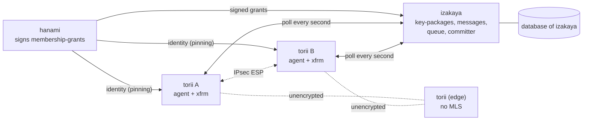

All instances of izakaya compare times, which another instance wrote, like the last contact of a
torii or the start of an operation. So they don't use their own clocks, but the clock of the
database-server, which they share. Their own clocks may differ, for example after a virtual
machine was paused.

### Trust

hanami is the only one, who decides about the membership. Its public key is part of the configs of
izakaya and of every torii. A grant names the vni, the identity of the torii and its MLS
signature-key, which hanami pins with the first grant of a host:

- izakaya only accepts grants with a valid signature of hanami and only queues the addition of a
  torii, which has a grant.
- The committer checks the grant again, before it adds a torii, and only claims a key-package, which
  has exactly the granted signature-key.
- Every other member checks every addition of a commit against the grants, which are attached to
  the commit, before it follows the commit.

So neither a compromised izakaya nor a compromised torii can bring a torii into a group, which
hanami didn't allow.

The switch of the keys is coordinated by the two torii of a pair with MLS-messages, which are
encrypted and signed within the group (see [Key-change of a pair](#key-change-of-a-pair)). Which
pairs move to a new epoch, every member reads from the commit itself. So izakaya can hold messages
back, which only delays the switch, but it can't make a torii switch or remove keys too early.
It can still remove a torii, because only izakaya sees, which torii is silent; every member logs
every removal of a peer with a warning, which names the committer.

The pinned identity is only replaced, when the sakura-host registers itself again, which needs the
registration-key, which already decides, which hosts take part at all (see
[Restart of a sakura-host](#restart-of-a-sakura-host)).

The internal endpoints of torii are authorized by the internal API-key alone, without the token of
a user, because hanami calls them also from its background-jobs, like the restore of a host. They
are only reachable over the internal port of torii.

## Placing a VM: identity-pinning and grant

hanami grants the membership with every VM of an encrypted network, which it places on a host,
before it creates the encrypted routes of the VM. It doesn't wait for the group: the torii join it
on their own.

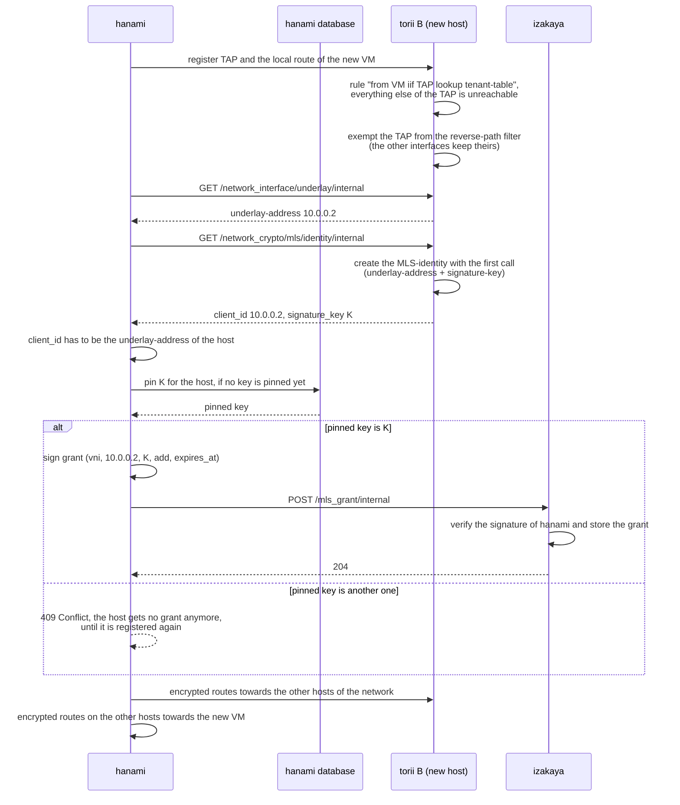

### A further VM on the same host

The membership belongs to the host and the network, not to a single VM. A further VM of the
network on a host, whose torii is already member of the group, changes nothing for the group:

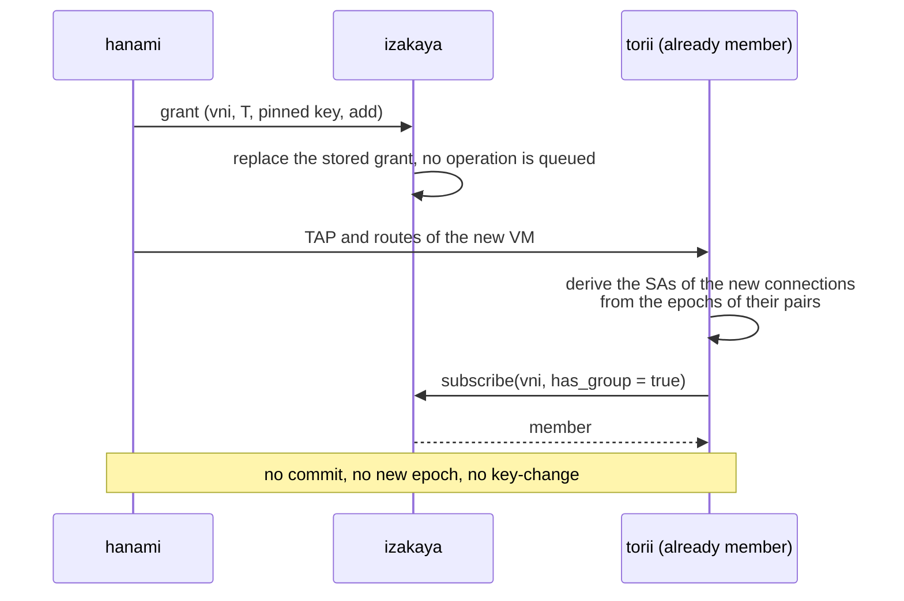

### Refresh of the grants

Every instance of hanami refreshes all grants regularly from its own database: every host with a
VM of a network and a pinned signature-key gets its grant again. This keeps the grants of the
hosts, which keep their VMs, from expiring and brings them back, if izakaya lost them. The torii
is not asked for its key here, the pinned key is used.

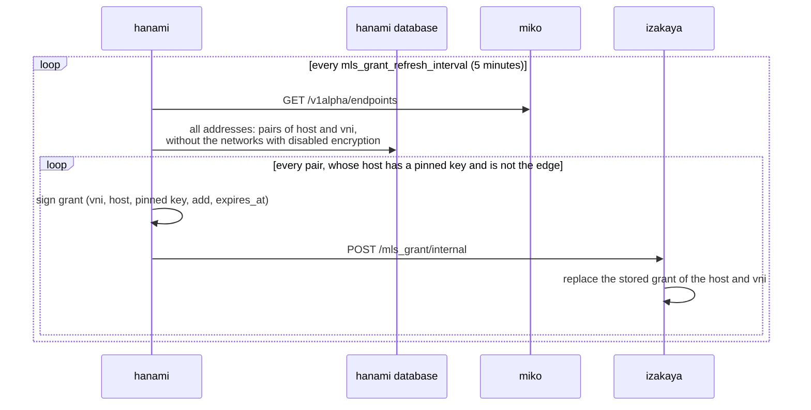

## Background-loop of the torii

Every second the agent of a torii runs through the same steps. Which groups it subscribes to only
depends on its own routes: the network has a VM behind this torii and an encrypted route towards
another host.

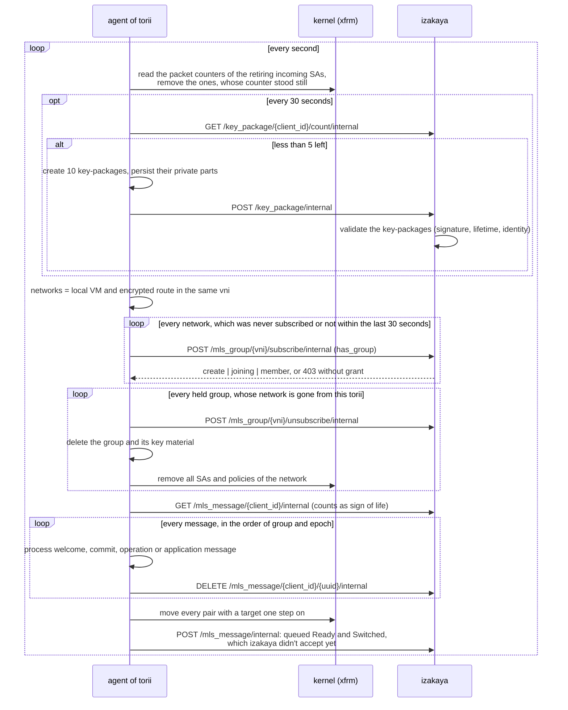

An application message of an epoch, which the group didn't reach yet, because its commit is not
processed yet, waits in the state of the torii and is processed after the next commit.

## Creating a group and adding a second torii

The first torii, which subscribes to a network, creates its group and becomes its committer. Every
further torii is added by the committer. Both get grants from hanami, when their VMs are placed.

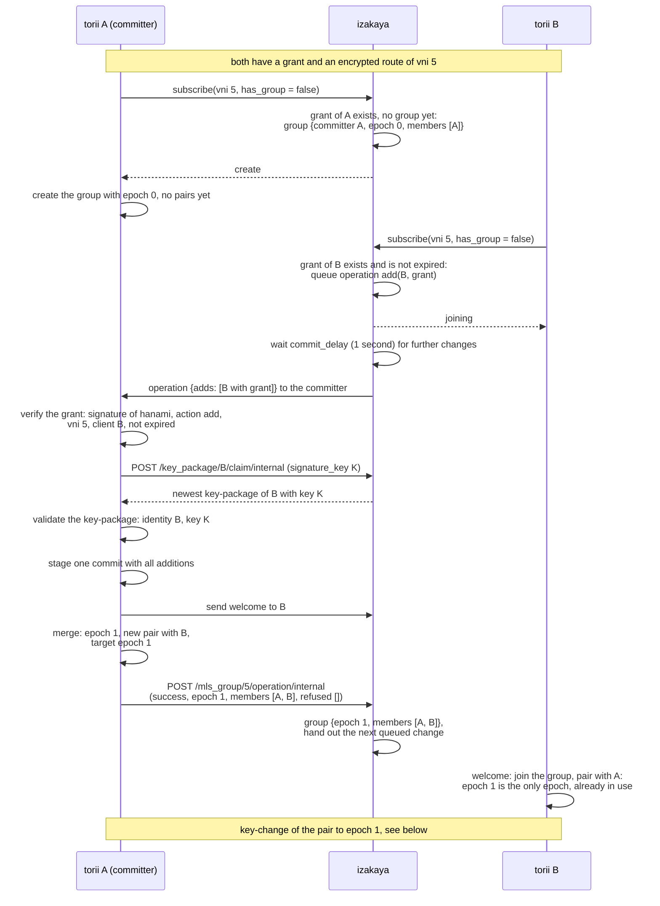

All additions and removals, which are queued within `commit_delay`, are handed to the committer
as one batch and are made with one commit. An addition, which the committer can't verify, is left
out and reported as `refused`, the others go on; izakaya queues the refused one again, until it
ran out of retries. A key-rotation is never part of a batch with additions or removals.

## Adding a torii to a group with more members

With more members, the commit of the addition goes to all other members. The grants of the new
torii are attached to it, so every member can check, that hanami allowed every addition.

An addition only moves the pairs with the new torii to the new epoch. The pairs between the other
members keep their epochs, so the new torii can't derive the keys of their traffic.

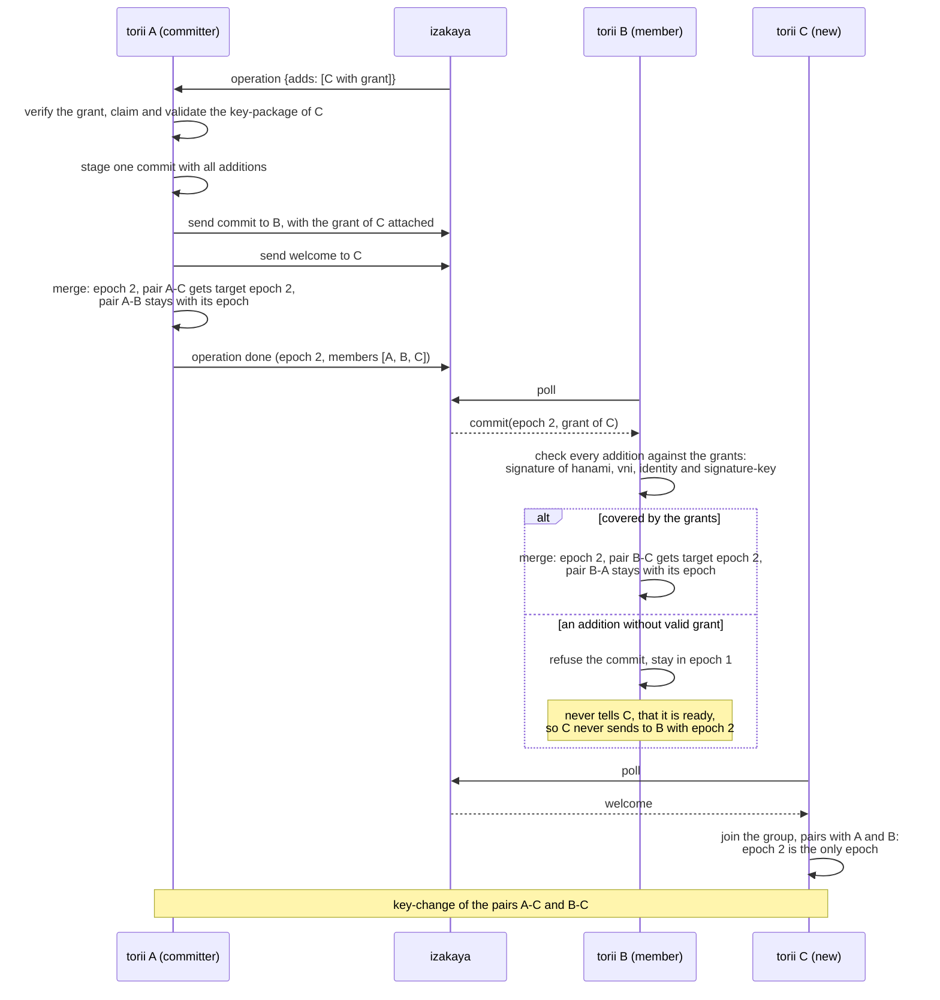

A torii, which lost its group and is added again, is removed and added in the same commit. This
only moves its own pairs as well.

## Key-change of a pair

A *pair* is a torii and one other torii in one network. All connections between the VMs of the
two torii change their keys together. Every pair has its own epoch for its outgoing traffic, which
can lag behind the epoch of the group, and a *target*, the epoch it moves to. The epochs of a pair
are counted per *generation*: every group of the network, which a torii creates or joins, is a new
generation, so the epochs of a newer group are always newer.

Which pairs get a new epoch as target, every member reads from the commit:

| Commit | Pairs, which move |
|---|---|
| adds or re-adds a torii | only the pairs with the added torii |
| removes a torii for good | all pairs, so the removed torii knows no key in use anymore |
| neither (key-rotation) | all pairs |

The two torii of a pair tell each other with two MLS application messages, how far they are:
`Ready` (I can receive with the target) and `Switched` (I send with the target). The messages
are encrypted and signed within the group, so izakaya only delivers them. A message only counts
for the pair with its sender and only, if it names the receiver and is newer than the last one.
It names the epoch only within the group, because every torii counts its generations on its own;
the receiver can only decrypt it with its current group, so it belongs to its current generation.
Every pair moves on its own and only waits for its own kernel and for its peer:

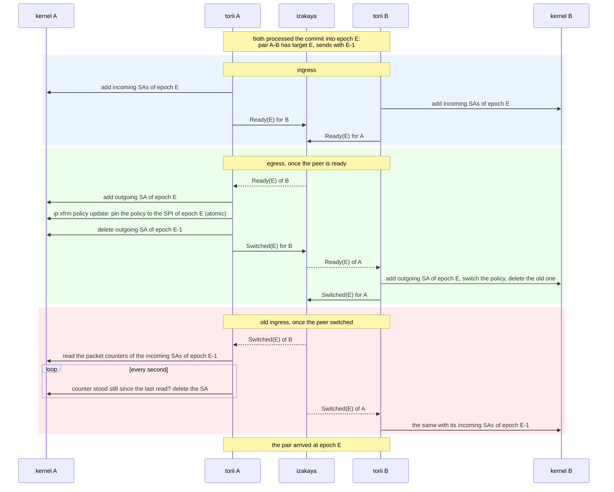

- Without a `Switched` of the peer, old incoming keys are never removed. The peer only sends it
  after its policies point at the new keys, so every packet with the old keys was handed to its
  kernel before. An old incoming SA is kept as long as packets arrive with it.
- A step, which fails, is tried again with the next loop; the reason is shown in the status of
  the pair. A pair, which doesn't move, keeps its old keys, which still work on both ends.
- A new target, while a pair is still moving, replaces the old one. The incoming keys of the old
  target stay, until the peer switched to something newer.
- `Ready` and `Switched` wait in the state of the torii, until izakaya accepted them, and the
  torii remembers, what it already sent. So a restart sends nothing twice and loses nothing.

The state of all pairs is shown by `GET /v1alpha/network_crypto/mls/status/internal` of the torii:
per pair the epochs of its outgoing and incoming keys, its target, the step it waits for
(`ingress`, `peer_ready`, `egress`, `peer_switched`, `old_ingress_in_use` or `nothing`) and its
last error.

### Key-derivation

All members export the same base secret from an epoch, as soon as they enter it, and derive the
SA of every direction of every VM-pair from it. The receiving torii derives exactly the key, which
the sending torii uses.

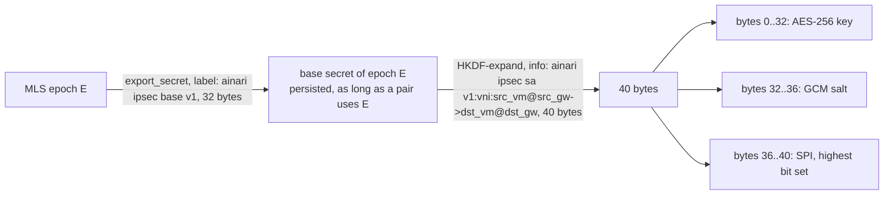

## Removing a torii

A torii only leaves the group, when the last VM of the network is deleted from its host. As long
as another VM of the network runs there, only the connections of the deleted VM are removed. After
the last one, hanami removes the routes and revokes the grant. The torii itself unsubscribes as
well, as soon as its routes of the network are gone. Both lead to the same removal, which is only
queued once.

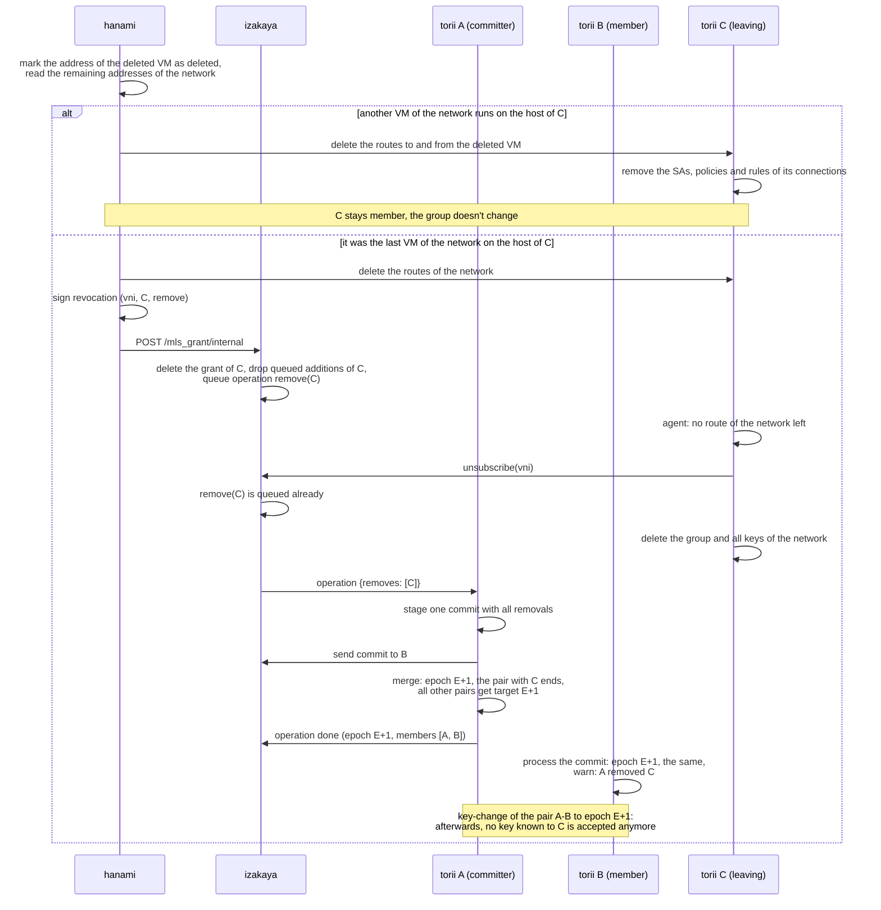

If the leaving torii is the committer, another living member becomes committer before the removal
is handed out. If it is the last member, the group is deleted together with its queue.

## Regular key-rotation

Groups, whose membership doesn't change, get new keys as well. This also keeps the sequence
numbers of the SAs far away from their end.

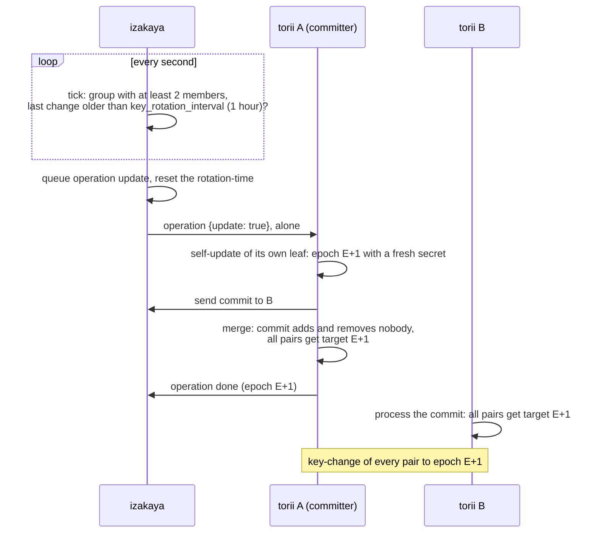

An update, which is queued next to a batch with a removal, is done with that batch, because the
removal moves all pairs as well.

## Changed routes

The keys only exist for the routes, which the torii has. A route, which is added, changed or
deleted, brings the keys of its network in line right away, without any message to the izakaya.

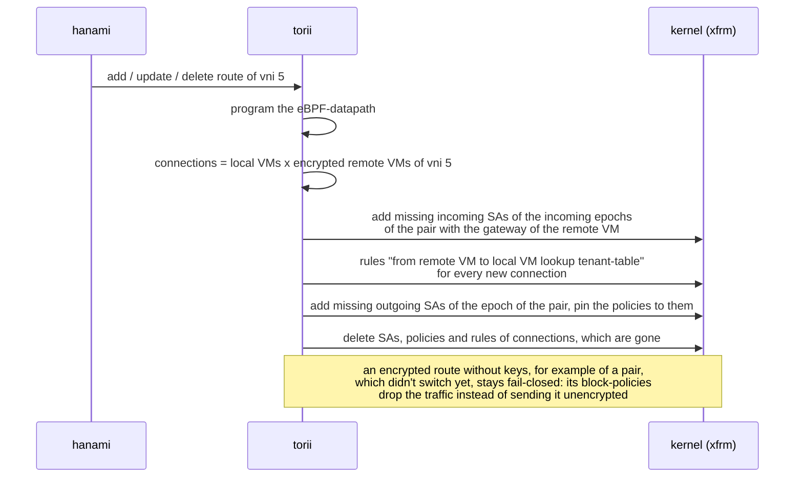

### Path of an encrypted packet

The eBPF-datapath hands the packets of an encrypted route to the kernel, which encrypts, decrypts
and routes them. The routing rules make sure, that a packet only takes the table of its tenant:

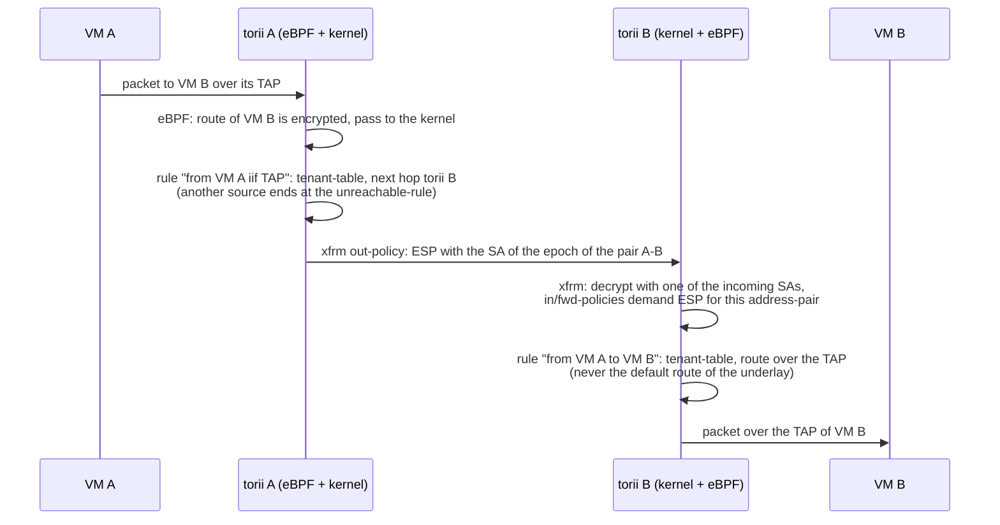

## Failures

### Restart of a torii

The MLS-state of a torii is persisted in its database, so a restart of the torii alone, which keeps
its database and its address, changes nothing for the group. A restart of the whole sakura-host,
which gives the torii a new address, is described in
[Restart of a sakura-host](#restart-of-a-sakura-host).

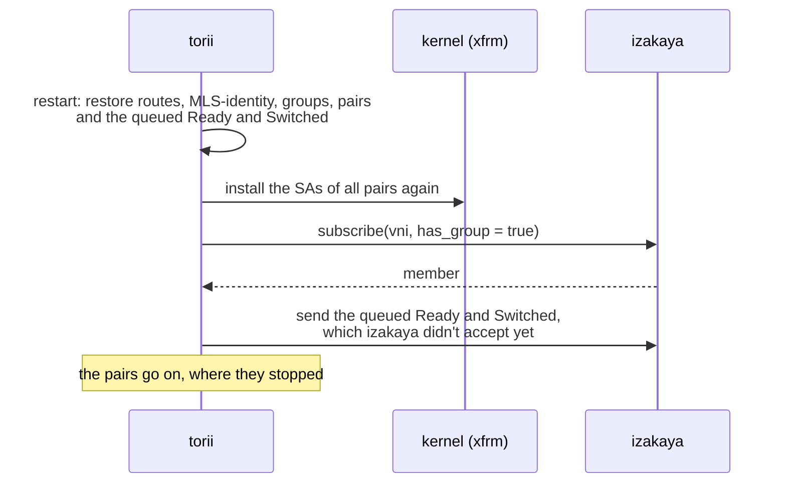

### Torii lost its MLS-state

The MLS-identity of a torii is part of its MLS-state. A torii, which lost its database, while its
sakura-host keeps running, comes back with the same address, but with a new signature-key. hanami
pinned the old key, and the grant at izakaya still names it, so the committer finds no key-package
with the granted key and refuses the addition. The encrypted routes of the torii stay fail-closed,
until sakura registers its host again, for example with its next restart, which lets hanami pin
the new key.

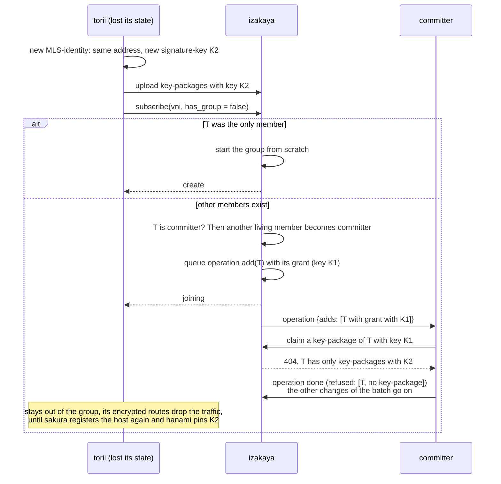

### Restart of a sakura-host

In kubernetes, sakura and the torii in front of it keep their databases and the disks of the VMs
in a directory of the node (`sakura.host_data_path`, `<pod-name>/sakura` and `<pod-name>/torii`),
which outlives the pod. A sakura-host, whose pod is recreated, still loses:

- the cloud-hypervisor processes of its VMs, which end together with sakura.
- the address of the torii in front of it. The torii restores its TAP-devices, routes and
  packet-filters from its database, but its MLS-identity is its address, so it drops its old
  MLS-state and starts with a new identity and without groups. The torii of the other hosts and
  the torii at the edge still route the VMs of the host to its old address, and the groups still
  contain its old identity.

Sakura registers its host with every start again. hanami takes this as the sign, that the torii
may have a new address: it forgets the pinned identity and, in the background, pins the new one
and changes the routes of the torii at the edge and of the other hosts to the new address. Sakura
boots the VMs again, which were running. Every step only changes, what differs, so a host, which
kept its address, for example because only sakura restarted, is left as it is.

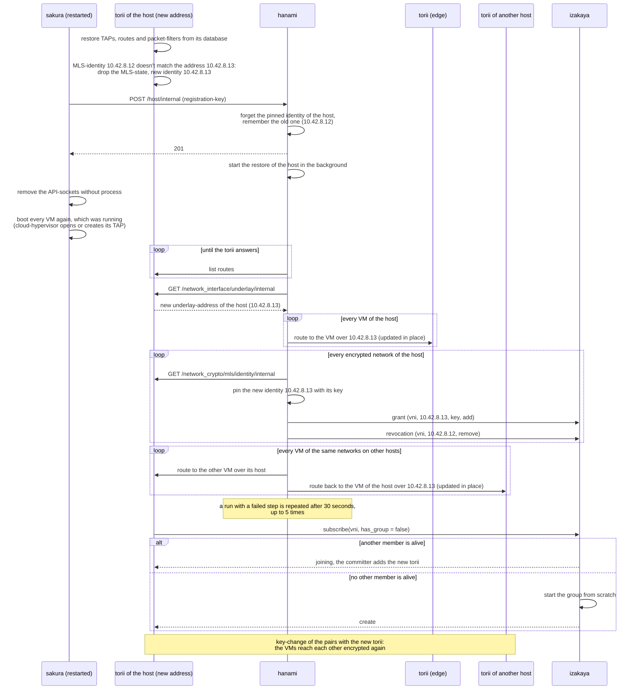

Addresses without a VM, for example of a reservation, which failed halfway, are left out.

### Silent members

Every torii polls the izakaya every second. A member, which didn't for 120 seconds
(`member_timeout`), is gone, for example because its host came back in a new pod with a new
identity, and is removed from its groups. As long as it is member, only its own pairs wait for it
(see [Slow peer](#slow-peer)), and the others can't remove the keys, which it knows. A torii,
which was only cut off, isn't lost: it subscribes again with its grant and is added again.

If no other member of a group is alive anymore, nobody can add a torii, which subscribes. The
group is started from scratch with that torii then. A member, which only was cut off, joins the new
group again, which replaces its old one without losing a packet (see
[Restart of izakaya](#restart-of-izakaya)).

Both only happen, once the izakaya itself runs longer than the timeout, because before that, a
torii, which didn't contact it yet, can't be told apart from a gone one.

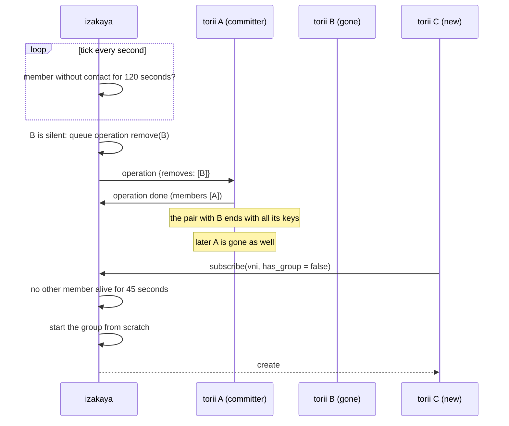

### Dead committer

A torii counts as dead, when it didn't poll for 45 seconds. An operation, which is not finished
after 30 seconds, is handed out again as a whole batch, if necessary to another committer. After 3
attempts it is given up.

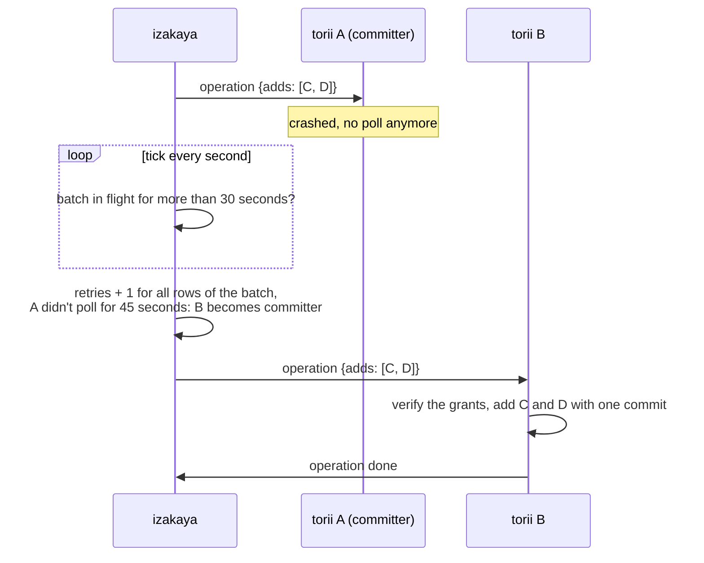

### Slow peer

A torii, which is down, slow or refused a commit, only holds back its own pairs. The other pairs
move on, and izakaya hands out the next change right after the last one. Nobody loses a key: a
pair, whose peer doesn't answer, keeps sending with its old epoch, which the peer can still
decrypt, and keeps the incoming keys of the old epoch, until the peer switched.

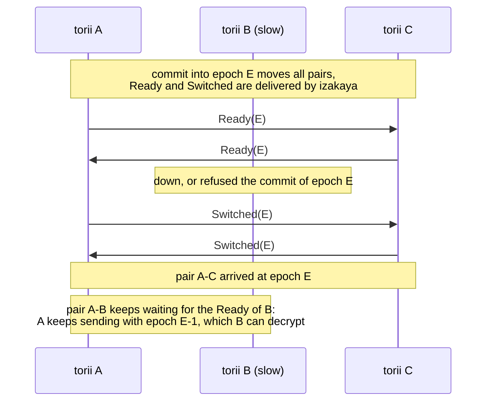

A torii, which stays silent, is removed after `member_timeout`, which ends its pairs (see
[Silent members](#silent-members)).

### Restart of izakaya

All state of izakaya is in its database, so a restart of one instance changes nothing.

If the database is lost, the grants, the key-packages, the queues and the groups are lost with it.
Everything comes back on its own:

- hanami brings the grants back with its next refresh.
- The torii upload new key-packages, as soon as they see, that izakaya has less than 5 of them.
- The torii renew their subscriptions every 30 seconds. The first one gets `create` and starts a
  new group, the others join it.

The new group is the next generation. Its pairs move to it like to any new epoch: the torii keep
sending with the keys of the old group, until the peer of the pair is ready with the new one, and
keep the incoming keys of the old group, until the peer switched. So the replacement of the group
doesn't lose a packet either. A pair, whose peer doesn't join the new group within 120 seconds,
ends with all its keys, and its connections fall back to fail-closed.

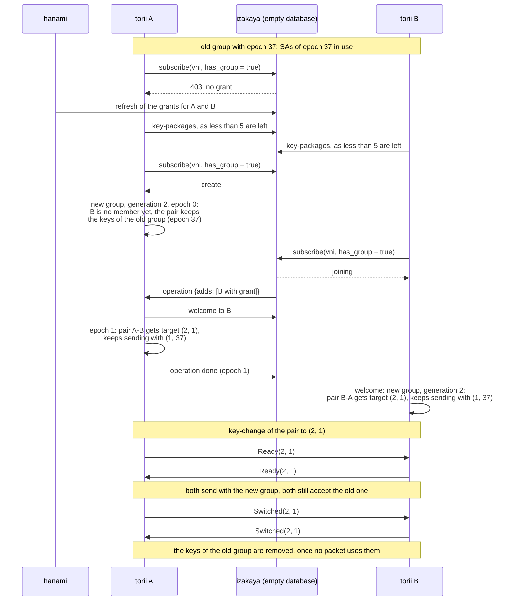
